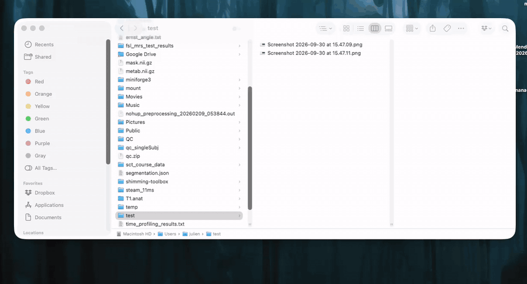
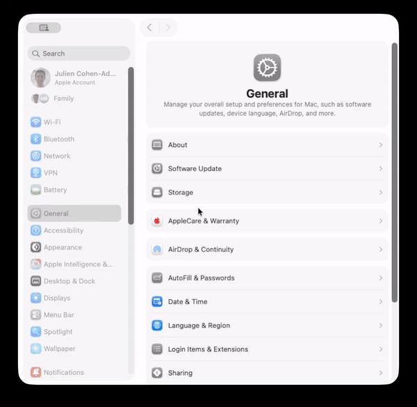

# macos-create-gif

A Finder **Quick Action** that turns selected images into an animated GIF.
Select images → right-click → **Quick Actions → Create GIF**.



- No dependencies: uses only built-in macOS frameworks (ImageIO via JavaScript for Automation).
- Frames are ordered by file name (natural sort, so `2.png` comes before `10.png`).
- Asks for the delay per frame (default 0.5 s) and the resolution as a percentage of the original size (default 50 %).
- Frames are scaled accordingly (never upscaled), respecting EXIF orientation.
- The GIF loops forever and is saved as `animation.gif` next to the first image (`animation 2.gif`, … if it already exists).
- Works with any image format macOS can read (PNG, JPEG, HEIC, TIFF, …).

## Installation

### Option 1: install script

```bash
git clone https://github.com/jcohenadad/macos-create-gif.git
cd macos-create-gif
./install.sh
```

### Option 2: manual

[Download the ZIP](https://github.com/jcohenadad/macos-create-gif/archive/refs/heads/main.zip), unzip it, and double-click `Create GIF.workflow`. macOS asks whether to install the Quick Action; click **Install**.
You can also copy `Create GIF.workflow` into `~/Library/Services/` yourself.

### Enable the Quick Action

If **Create GIF** doesn't show up in the right-click menu, open
**System Settings → General → Login Items & Extensions**, scroll to **Extensions**, click **By Category → Finder**, and switch on **Create GIF**.



## Usage

1. In Finder, select two or more images.
2. Right-click → **Quick Actions → Create GIF**.
3. Enter the number of seconds per frame and click **Next**, then the resolution in % and click **Create**.
4. `animation.gif` appears in the same folder.

The first time you use it in a protected folder (Desktop, Documents, Downloads), macOS may ask for permission.

## Customization

Open `~/Library/Services/Create GIF.workflow` in Automator to edit the script. Useful settings in the script:

| Variable | Default | Meaning |
|----------|---------|---------|
| `delay`  | `0.5`   | Default seconds per frame shown in the dialog |
| `scale`  | `50`    | Default resolution (% of original size) shown in the dialog |

The same script is available on its own in [`src/create-gif.sh`](src/create-gif.sh), which you can run from the terminal:

```bash
./src/create-gif.sh frame1.png frame2.png frame3.png
```

## Uninstall

```bash
rm -rf ~/Library/Services/"Create GIF.workflow"
```

## License

[MIT](LICENSE)
